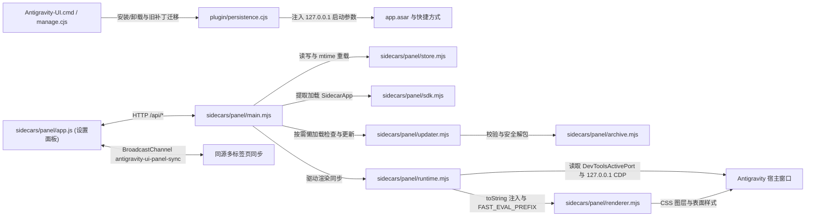
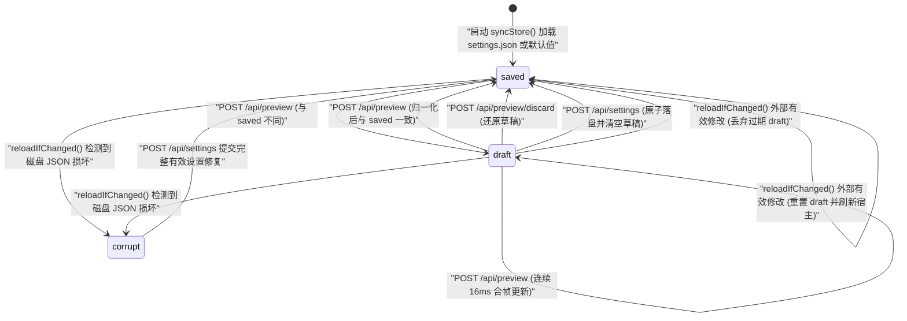
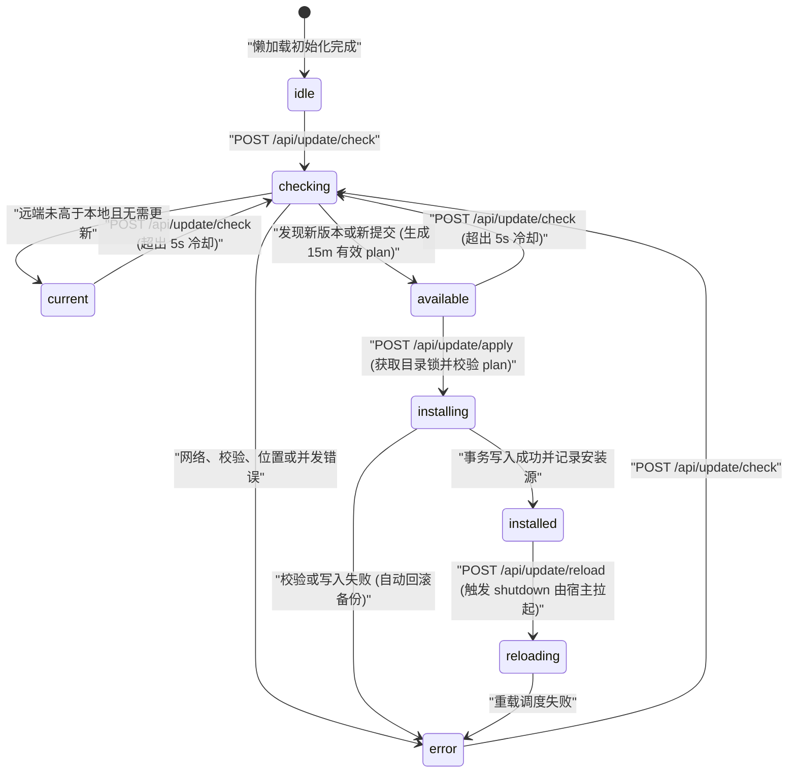

# Antigravity Background 架构与实现说明

本文档聚焦 **模块边界、数据流、状态机、接口索引与关键设计取舍**，不重复抄录源码中的配置字段默认值、校验范围或逐版 DOM 修复明细（配置字段以 [plugin/appearance.cjs](plugin/appearance.cjs) 为单一事实来源，历史演进细节见 [docs/adr/0001-live-preview.md](docs/adr/0001-live-preview.md)）。

## 1. 系统架构与数据流

## 2. 模块职责边界

| 模块 | 职责与核心约束 |
| :--- | :--- |
| [Antigravity-UI.cmd](Antigravity-UI.cmd)、[manage.cjs](manage.cjs) | Windows 交互入口与 CLI 管理器（`install` / `uninstall` / `status`）。通过 `safeDirectory` 校验安装目标必须为真实目录（禁止 symlink/junction），维护 `config.json` 启停状态与 `antigravity-ui.install.json` 安装目录记录，并自动迁移旧版 `dist/antigravity-ui/original.json` 补丁。 |
| [plugin/appearance.cjs](plugin/appearance.cjs) | 前后端共用的配置单一事实来源：定义配置归一化 `normalize()`、表面样式提取 `surfaceConfig()`、壁纸 CSS 生成 `wallpaperStyle()` 及边缘取色 `extractBorderColor()` / `extractCanvasBorderColor()`，并对图片 data URL 维护最多 4 项的校验缓存 `verifiedImages`。 |
| [plugin/persistence.cjs](plugin/persistence.cjs) | 跨重启双保险持久化共享模块：在 `resources/app.asar` 的 `dist/main.js` 注入仅限 `127.0.0.1` 的 `app.commandLine.appendSwitch` 并生成 SHA-256 备份；扫描桌面、OneDrive、开始菜单与任务栏快捷方式补齐调试参数并备份原始参数；提供 `replaceAtomic` Windows 重试。 |
| [sidecars/panel/main.mjs](sidecars/panel/main.mjs) | Sidecar HTTP 服务入口：启动时并行检查中断更新事务、优先直连 `sidecar_sdk`（缺失时按需动态加载 [sidecars/panel/sdk.mjs](sidecars/panel/sdk.mjs)）与同步存储，确认无待恢复事务后即并发启动 `WallpaperRuntime` 与 `app.run()`；静态面板资源延迟到首次打开设置页时并行读取并缓存；通过串行请求队列 `enqueueRequest` 协调心跳、预览、保存与外部重载；按需懒加载 `updater.mjs` 与 `persistence.cjs`，并基于 `stat` 签名缓存 `config.json` 启用状态。 |
| [sidecars/panel/sdk.mjs](sidecars/panel/sdk.mjs) | Sidecar SDK 回退加载器：当直接导入 `sidecar_sdk` 模块失败时按需加载，以 4MB 分块 + 64KB 重叠流式扫描 `language_server.exe` 嵌入式资源，校验 `127.0.0.1` 绑定约束后按摘要缓存至数据目录 `sdk/`。 |
| [sidecars/panel/store.mjs](sidecars/panel/store.mjs) | 配置持久化存储：通过 `SettingsStore` 串行队列执行原子写（临时文件 + Windows 退避重试重命名），按 `mtimeMs`/`ctimeMs`/`size`/`ino` 签名执行 `reloadIfChanged()` 感知外部变更，自动兼容迁移旧版 `antigravity-ui-wallpaper.json`，文件损坏时保留最近有效设置直至面板重新保存修复。 |
| [sidecars/panel/runtime.mjs](sidecars/panel/runtime.mjs) | CDP 运行时控制器：采用纯 `node:http` 与轻量 RFC 6455 环回客户端避免冷启动加载 `undici`；按需懒序列化注入源码；读取 `DevToolsActivePort` 并过滤环回页面目标与子级插件 OOPIF 目标，按 `[80, 120, 200, 350, 600, 1000, 1500]ms` 自适应退避附加（稳态 `1500ms` 心跳）；主窗口上屏后立即发布 `health`，合并宿主插件槽位扫描与 `color-scheme` 批量回写、对稳态未变更插件 iframe 实行 3000ms 降频续租；维护宿主 `connections` 与右侧栏插件 `pluginConnections` 连接池、租约 `generation`/`owner`、250ms 窗口发现节流及 `lastImageHash` 增量传输。 |
| [sidecars/panel/renderer.mjs](sidecars/panel/renderer.mjs) | 宿主与插件面板渲染器：`installWallpaper` 与 `installPluginPanelSurface` 均保持零外部闭包以支持 `toString()` 注入且消除顶层 `await`；写入 DOM/CSSOM 前先批量预读宿主布局与标题栏颜色以消除强制同步样式重算，并将浮动滚动条同步、浏览器孔洞挖空/Shadow DOM 浮层遮挡代理与图片自然比例探测延后至动画帧/空闲回调；管理 `#antigravity-ui-background` 与表面样式表、`MutationObserver` 标题栏透明度防护、`[data-browser-hole]` 隔离、浮动滚动条视口裁剪、真实窗口比例采样，以及右侧栏跨源插件面板（Sidecar UI / MCP App）通用表面透明化与 `color-scheme` 对齐。 |
| [sidecars/panel/updater.mjs](sidecars/panel/updater.mjs)、[sidecars/panel/archive.mjs](sidecars/panel/archive.mjs) | GitHub 在线更新器与安全归档解包器：严格按 GitHub Release 语义化版本号（优先 ZIP + SHA-256 校验，无 ZIP 时回退 Release Tag 源码包，API 限流自动走 Release 公开页面降级）检测更新，不按 `main` 分支 git 提交推送，支持环境变量与 Windows 注册表代理回退；通过目录锁 `.antigravity-ui-update.lock` 与 `updates/tx-*` 事务备份保障失败回滚与启动自恢复；`archive.mjs` 拦截路径穿越、Windows 保留设备名并排除 `data`/`sdk` 受保护目录。 |
| [sidecars/panel/index.html](sidecars/panel/index.html)、[sidecars/panel/styles.css](sidecars/panel/styles.css)、[sidecars/panel/app.js](sidecars/panel/app.js) | 设置页 UI 与前端交互：在入口顶部短路 Antigravity 冷启动预加载的 `0x0` / 隐藏嵌入式面板 iframe，跳过全部滑块 DOM 构建、`CSSStyleSheet`、`BroadcastChannel`、样式探测、API 请求与图片解码直至真正显示，并延后 `#drag-preview-stage` 模板克隆到打开弹窗时；提供双列折叠卡、16ms 合帧预览、`imageHash` 省略传输、`#drag-preview-modal` 1:1 比例拖拽预览弹窗、`BroadcastChannel` 多标签页同步，以及 `MISSING_DEVTOOLS_PORT` 引导与插件更新弹窗。 |

## 3. 核心状态机

### 3.1 预览草稿与持久化状态机

### 3.2 在线更新器状态机（`PluginUpdater`）

## 4. Sidecar HTTP 路由与环境变量索引

### 4.1 静态资源与 HTTP API 路由

静态路由：`GET /`（[sidecars/panel/index.html](sidecars/panel/index.html)）、`GET /app.js`（[sidecars/panel/app.js](sidecars/panel/app.js)）、`GET /styles.css`（[sidecars/panel/styles.css](sidecars/panel/styles.css)）、`GET /appearance.js`（[plugin/appearance.cjs](plugin/appearance.cjs)）。

| 路由 | 职责与边界说明（详见 [sidecars/panel/main.mjs](sidecars/panel/main.mjs)） |
| :--- | :--- |
| `GET /api/settings` | 触发外部变更检查 `syncStore()`，返回当前活动配置（`draft \|\| store.settings`）、`hasDraft`、`imageHash` 与 `runtime` 健康状态。 |
| `POST /api/preview` | 校验并更新内存预览草稿 `draft`；支持仅传 `imageHash`（未命中缓存返回 `409 IMAGE_CACHE_MISS`）；仅在样式变化或待刷新时触发宿主更新。 |
| `POST /api/preview/discard` | 清空内存 `draft`，恢复 `store.settings` 对应外观并强制发现宿主窗口刷新。 |
| `POST /api/settings` | 经 `SettingsStore.save()` 原子写入 `settings.json` 并清空 `draft`；在 `settingsError` 损坏状态下要求提交完整键集方可修复。 |
| `POST /api/repair-shortcuts` | 懒加载 [plugin/persistence.cjs](plugin/persistence.cjs)，在 Windows 上补齐快捷方式调试参数并返回 `app.asar` 自启开关状态。 |
| `GET /api/update` | 懒加载 [sidecars/panel/updater.mjs](sidecars/panel/updater.mjs) 并返回只读公开状态（不主动发起联网请求）。 |
| `POST /api/update/check` | 发起 GitHub 更新检查（遵循 5 秒冷却窗口与 Release 优先策略），立即返回当前状态快照。 |
| `POST /api/update/apply` | 校验 `plan` 后加锁执行下载、归档校验、备份与事务替换，失败时执行备份回滚。 |
| `POST /api/update/reload` | 仅在 `installed` 状态下触发 Sidecar 优雅退出，由宿主 `restart_policy: "always"` 拉起新版本。 |

### 4.2 环境变量索引

| 变量名 | 默认值 / 来源 | 用途与约束 |
| :--- | :--- | :--- |
| `AG_UI_HOME` | `os.homedir()` | 覆盖用户主目录，供测试或隔离运行派生配置与默认路径。 |
| `AG_UI_PROFILE` | `<home>/AppData/Roaming/Antigravity` | Antigravity 用户数据目录，用于读取 `DevToolsActivePort` 与旧版配置迁移。 |
| `AG_UI_RESOURCES` | `<home>/AppData/Local/Programs/antigravity/resources` | 定位内置 `bin/language_server.exe` 以提取 Sidecar SDK。 |
| `AG_UI_INSTALLATION` | 由 `process.execPath` 或 `AG_UI_RESOURCES` 父目录推导 | Antigravity 安装根目录，用于检查 `app.asar` 与匹配修复快捷方式。 |
| `AG_UI_UPDATE_ENDPOINTS` | 未设置（仅限测试/本地覆盖） | JSON 字符串，仅接受 `127.0.0.1` 或 `localhost` 协议源的 `apiBase`、`webBase`、`rawBase`、`codeloadBase`。 |
| `ANTIGRAVITY_EXECUTABLE_DATA_DIR` | 宿主注入（缺省回退 `~/.gemini/antigravity/sidecar_data/antigravity-ui/panel/data`） | Sidecar 私有持久化数据目录，存放 `settings.json`、`sdk/` 与 `updates/`。 |
| `ANTIGRAVITY_LS_ADDRESS` | 宿主注入 | Language Server 地址；提取端口用于 `validTarget()` 过滤匹配的宿主 CDP 页面目标。 |

> 代理环境说明：`resolveSystemProxy`（[sidecars/panel/updater.mjs](sidecars/panel/updater.mjs)）按标准进程环境变量 `https_proxy`、`http_proxy`、`all_proxy`、`no_proxy`（大小写不敏感）优先解析，未配置时回退读取 Windows `Internet Settings` 注册表代理。

## 5. 关键机制、磁盘布局与防文档腐烂约束

### 5.1 关键机制与设计取舍

- **CDP 增量同步与租约判优**：[sidecars/panel/runtime.mjs](sidecars/panel/runtime.mjs) 首次附加或复检非宿主目标时先以 77 字节轻量表达式探测宿主指纹（避免向非宿主页面序列化/注入完整渲染源码与大图），对已确认宿主按 `RENDERER_VERSION:RENDERER_REVISION` 复用 `FAST_EVAL_PREFIX` 并按 `lastImageHash` 省略大图，仅在目标重载返回 `'NEED_IMAGE'` 时补发完整图片。宿主侧 `shouldIgnoreLease` 按 `version > revision > generation > owner` 裁决多实例写入，确保停用（`enabled: false`）旧请求不会覆盖高代次会话。
- **跨重启持久化与安装边界**：[plugin/persistence.cjs](plugin/persistence.cjs) 在 `app.asar` 早期入口与桌面/菜单/任务栏快捷方式双路注入仅限本机 `127.0.0.1` 的调试端口开关，既保留协议拉起与裸程序启动能力，又通过 SHA-256 备份和参数备份实现无损卸载。
- **事务更新与目录锁**：[sidecars/panel/updater.mjs](sidecars/panel/updater.mjs) 使用目录锁（内含 `owner-<pid>-<uuid>` 标记）替代单文件锁以支持回收已退出进程残留锁；更新前将受影响文件备份至 `updates/tx-<uuid>/backup` 并写入事务日志，启动时通过 `hasPendingUpdateTx` 自动触发恢复。

### 5.2 磁盘目录与关键文件布局

- **插件运行目录**：`~/.gemini/config/plugins/antigravity-ui`（含 `plugin.json`、`plugin/`、`sidecars/`、`assets/` 与可选 `.install-source.json`；必须为真实目录）。
- **配置与持久化备份**：
  - `~/.gemini/config/config.json`（启停配置及安装前 `.bak`）
  - `~/.gemini/config/antigravity-ui.install.json`（记录自定义安装目录）
  - `~/.gemini/config/antigravity-ui.shortcuts.bak.json`（快捷方式原始参数备份）
  - `<installation>/resources/app.asar.antigravity-ui.persist.<sha256>.bak`（原始 `app.asar` 备份）
- **Sidecar 数据目录**（`ANTIGRAVITY_EXECUTABLE_DATA_DIR`）：
  - `settings.json`（当前已保存配置；首次加载兼容读取 `<profile>/antigravity-ui-wallpaper.json`）
  - `sdk/`（嵌入式 SDK 提取缓存 `cache.json` 与 `<digest>/index.mjs`、`preload.js`）
  - `updates/`（暂存解包目录及 `tx-<uuid>/` 更新事务快照）

### 5.3 防文档腐烂约束

仓库通过 [tests/docs-sync.mjs](tests/docs-sync.mjs) 对文档与代码执行自动双向校验：

1. 清单版本、Sidecar 入口及 `RENDERER_VERSION` / `RENDERER_REVISION` 与 [README.md](README.md) 一致；
2. [manage.cjs](manage.cjs) `runtimeFiles` 与 [sidecars/panel/archive.mjs](sidecars/panel/archive.mjs) 运行时文件清单真实存在且同步于 [README.md](README.md)；
3. [sidecars/panel/main.mjs](sidecars/panel/main.mjs) 注册的 `/api/*` 路由与本文档路由表双向一致；
4. 源码读取的 `AG_UI_*` / `ANTIGRAVITY_*` 环境变量与本文档环境变量表双向一致；
5. `tests/*.mjs` 脚本与 [manage.cjs](manage.cjs) 子命令均在 [README.md](README.md) 和 [AGENTS.md](AGENTS.md) 中有记录；
6. 文档中的相对链接、图片路径与源码路径引用全部解析到真实存在的文件。
