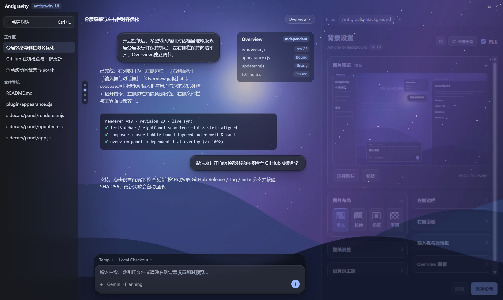
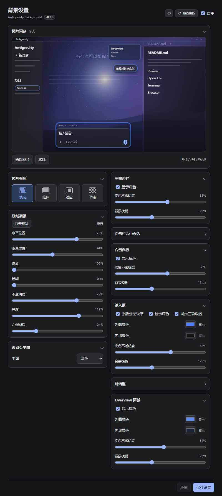
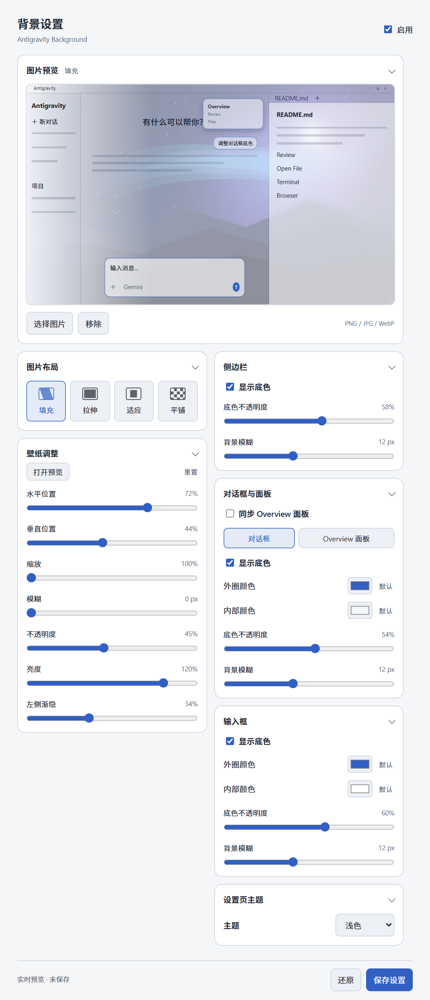
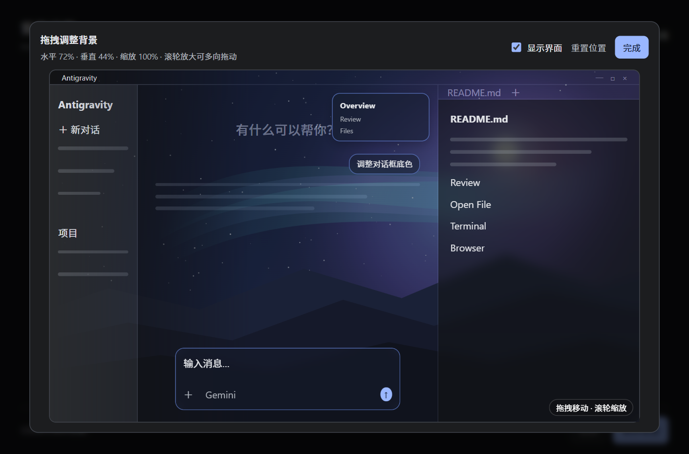

<div align="center">


# Antigravity Background

**Full-Window Wallpaper & Frosted Glass Surface Customization Plugin for Antigravity on Windows**

[](plugin.json)
[](#installation--entry-points)
[](#installation--entry-points)
[](docs/adr/0001-live-preview.md)
[](LICENSE)

[简体中文](README.md) · **English**

[Showcase](#showcase) · [Features](#features) · [Installation](#installation--entry-points) · [Persistence](#cross-restart-persistence--self-repair) · [Compatibility](#native-ui--compatibility-fixes) · [Repository Structure](#repository-structure)

</div>

---

**Antigravity Background** (plugin ID `antigravity-ui`) provides a live visual settings panel in the right auxiliary sidebar via Antigravity's official Sidecar extension API. It supports full-window custom wallpapers, four layout modes, interactive 1:1 drag-and-zoom preview, independent transparency and backdrop blur for the **Left Sidebar / Right Panel / Overview Panel**, independent or synchronized layered depth with a hollow outer ring for the **Selected Sidebar Row / Composer / User Message Bubble**, automatic dark/light theme adaptation, and reversible dual-layer persistence across restarts.

## Showcase

### Full-Window Wallpaper & Frosted Workspace

> The wallpaper spans the entire window—including the title bar and left sidebar—while keeping the conversation navigator dots, split sash handles, Overview overlay, third-party right-sidebar plugin panels, and settings UI crisp and interactive.



### Settings Panel (Dark / Light Themes) & Interactive Drag Modal

<table>
  <tr>
    <td width="50%" align="center">
      
      <br />
      <sub><b>Dark Theme Settings Panel</b> · 10 collapsible cards with one-click 3-surface sync &amp; hollow outer ring</sub>
    </td>
    <td width="50%" align="center">
      
      <br />
      <sub><b>Light Theme Settings Panel</b> · Independent colors per surface; hollow outer ring tints only the outer rim without bleeding into inner cards</sub>
    </td>
  </tr>
  <tr>
    <td colspan="2" align="center">
      
      <br />
      <sub><b>Interactive Drag Preview Modal</b> · Syncs 1:1 with the host window aspect ratio &amp; pane widths, supporting drag positioning, wheel zoom, and UI overlay toggle</sub>
    </td>
  </tr>
</table>

---

## Features

| Module | Description | Range / Default Behavior |
| --- | --- | --- |
| **Wallpaper & Layout** | Supports local **PNG / JPG / WebP** images (auto-resized up to `2560px` on the longest edge with alpha preserved) and **Fill / Stretch / Fit / Tile** modes | Fill · Stretch · Fit (default) · Tile |
| **Fine-Grained Controls** | Horizontal position (`0–100%`), vertical position (`0–100%`), scale (`20–220%`), blur (`0–30 px`), opacity (`0–100%`), brightness (`30–140%`), left fade (`0–95%`) | Responsive container-query sizing (`cqw` / `cqh`) keeps framing consistent across monitors, DPI changes, and fullscreen/windowed resizing; live preview on every input |
| **Interactive Drag Modal** | Top preview renders a read-only 1:1 miniature of the real Antigravity window; clicking "Open Preview" opens a modal canvas for drag panning and scroll-wheel zooming | Non-tile modes enforce a `100%` effective scale floor and clamp panning to available overflow so edges never expose blank gaps |
| **Left Sidebar Surface** | Independent toggle for surface fill, opacity (`0–100%`), and backdrop blur (`0–30 px`) | Single flat glass layer covering the docked/peek/drawer sidebar, clearing nested sticky `.bg-sidebar` blocks and top inner shadow seams |
| **Right Panel Surface** | Independent toggle for surface fill, opacity (`0–100%`), and backdrop blur (`0–30 px`) | Covers `[data-side-panel-body]` cleanly (compatible with `[data-has-browser-hole]`) and automatically adapts third-party cross-origin Sidecar UI & MCP App OOPIF panels inside the right sidebar |
| **Selected Row / Composer / Bubble** | Three separate collapsible cards controlling native layered depth, fill toggle, outer/inner hex colors, opacity, and blur, plus an optional **Sync all three** toggle (enabled by default) | In layered mode, the outer color renders exclusively as a hollow `3–4px` outer ring + `1px` border (`mask-composite: exclude`) without tinting the inner card; tweak independently or keep all three in sync |
| **Overview Panel** | Independent flat card with fill toggle, outer/inner hex colors, opacity, and backdrop blur | Targets all 4 Overview overlay/gutter/sibling/dropdown hosts independently without syncing to composer/bubble settings |
| **Theme & Multi-Window Sync** | Supports Follow App / Dark / Light panel themes, multi-window auto-discovery, same-origin `BroadcastChannel` sync across open panels, and external `settings.json` reload | Live adjustments stay in Sidecar memory until **Save** writes atomically to disk; **Discard** reverts unsaved drafts |
| **In-App GitHub Updater** | Header displays current version, GitHub link, and **Check for Updates**; resolves GitHub Releases (ZIP + SHA-256), tags / `main` branch, and Atom feed fallback | Transactional staging with automatic rollback on failure and one-click hot reload; never initiates network requests passively on panel load |

The updater reclaims stale directory locks left by exited processes. If a legacy lock file persists after all Antigravity processes have exited, remove `.gemini/config/plugins/.antigravity-ui-update.lock` and restart the plugin.

---

## Installation & Entry Points

### Requirements

- **OS**: Windows
- **Runtime**: [Node.js](https://nodejs.org/) **22.2** or later
- **Host**: Antigravity Desktop

### Interactive Install / Uninstall / Status

1. Quit Antigravity completely (ensure the system tray icon is exited).
2. Double-click [`Antigravity-UI.cmd`](Antigravity-UI.cmd) in the repository root and choose:
   - `1`: Install / Update plugin (including dual-layer persistence setup)
   - `2`: Uninstall plugin (cleanly restores `app.asar` and shortcut arguments while preserving saved wallpaper settings and backups)
   - `3`: Check installation and persistence status

For custom Antigravity install directories or CLI automation, run [`manage.cjs`](manage.cjs) directly:

```powershell
# Install or update (optional custom Antigravity directory)
node manage.cjs install
node manage.cjs install "D:\Antigravity"

# Inspect plugin, app.asar boot switch, shortcuts, and active debug port
node manage.cjs status

# Uninstall and restore host files losslessly
node manage.cjs uninstall
```

### Opening in Antigravity

- Installed path: `~/.gemini/config/plugins/antigravity-ui`
- The installer automatically enables `plugins.antigravity-ui` and `sidecars["antigravity-ui/panel"]` in `~/.gemini/config/config.json` while backing up and preserving all other entries.
- After restarting Antigravity:
  - Inspect **Customizations → Installed** to verify **Antigravity Background**.
  - Open the right auxiliary sidebar and select **Extensions → Antigravity Background**.

---

## Cross-Restart Persistence & Self-Repair

Antigravity Desktop writes `DevToolsActivePort` only when launched with a local loopback debugging flag (`--remote-debugging-port=0 --remote-debugging-address=127.0.0.1`). Launches without that flag (bare shortcuts, `antigravity://` protocol links, or self-restarts) clear `DevToolsActivePort` and prevent automatic attachment.

This plugin includes reversible dual-layer persistence ([`plugin/persistence.cjs`](plugin/persistence.cjs)):

1. **Shortcut Argument Management**: Idempotently appends `--remote-debugging-port=0 --remote-debugging-address=127.0.0.1` to Antigravity shortcuts on Desktop, OneDrive Desktop, Start Menu, and Taskbar (including `AntigravityLauncher.exe` shortcuts) and backs up original arguments to `~/.gemini/config/antigravity-ui.shortcuts.bak.json`.
2. **Minimal `app.asar` Boot Switch**: Injects a loopback-only (`127.0.0.1`) `app.commandLine.appendSwitch` bootstrap into `resources/app.asar` (`dist/main.js`) with a `dist/antigravity-ui/persist.json` marker and a SHA-256 verified backup (`app.asar.antigravity-ui.persist.<sha256>.bak`), ensuring persistence even for protocol or bare executable launches. `uninstall` verifies hashes and restores `app.asar` and all shortcuts losslessly.
3. **One-Click Shortcut Repair**: If `MISSING_DEVTOOLS_PORT` is detected (for example after a host update overwrites `app.asar`), the panel footer surfaces a guided prompt and **Repair Shortcuts** button (`POST /api/repair-shortcuts`). Re-running `Antigravity-UI.cmd` option `1` after closing Antigravity restores full `app.asar` persistence.
4. **Legacy Patch Migration**: Automatically detects early-version patches (`dist/antigravity-ui/original.json`), restores original resources safely, and migrates legacy `antigravity-ui-wallpaper.json` settings on first run.

---

## Native UI & Compatibility Fixes

To prevent the full-window wallpaper layer (`z-index: 1000`) and translucent surfaces from interfering with native UI controls, the renderer (`version = 18 / revision = 34`) includes targeted adaptations:

- **Zero-Overlap Sidebar Conversation Actions**: After making `.agy-row-actions::before` transparent for wallpaper pass-through, hovered, keyboard-focused, or menu-expanded (`aria-expanded="true"`) sidebar rows with non-empty action buttons switch `.agy-row-actions` to in-flow layout and hide `.agy-row-status`, allowing `.truncate` titles to ellipsis cleanly to the left of action buttons with zero overlap and zero row-height shift.
- **Third-Party Right-Sidebar Plugin Panel Adaptation**: Automatically discovers and verifies cross-origin plugin OOPIFs mounted in the right sidebar (`plugin://` Sidecar UI plugins and `mcp-app-frame-slot` MCP App panels, excluding itself, opt-out `data-ag-ui-panel-native="true"` panels, full-page views, and inline conversation iframes), clearing opaque canvases, softening sticky bars and neutral cards, aligning cross-origin `color-scheme`, and restoring native appearance cleanly when disabled or at `100%` opacity.
- **Hollow Outer Ring & Independent/Synced 3 Surfaces**: Separates selected sidebar row (`.agy-sidebar-row[data-selected="true"]`), composer (`.surface-composer`), and user bubble (`.agy-user-bubble-frame`) into independent settings (`selectedRow*` / `composer*` / `bubble*`) with optional `syncDialogSurfaces` sync. Layered mode paints only the outer `3–4px` ring via `mask-composite: exclude` pseudo-elements so semi-transparent outer colors never bleed behind inner cards.
- **Titlebar Menu, Conversation Header, Right Tab Strip & Home View Elevation**: Elevates titlebar menu items, non-hole main header and right tab strip children, and `.agy-sheet .agy-home` above the wallpaper layer (`z-index: 1001`) while keeping outer wrappers at `z-index: auto` so dropdowns (`z-[8000]`) and top-bar wallpaper remain unobstructed.
- **Interactive Controls & Overlay Stacking**: Restores conversation navigator dots, overlay scrollbars, scroll-to-bottom button, find bar, selection/annotation popovers, terminal resize handle, split sashes (`[data-split-sash]` / `[data-testid="tiling-splitter"]`), and sidebar peek/drawer overlays.
- **Viewport Clipping for Body-Mounted Floating Scrollbars**: Tracks container geometry and ancestor overflow chains for `body > [data-overlay-scrollbar-track]` elements and clips overflow via `clip-path: inset(...)` so nested scrollable status cards never protrude over headers or the composer.
- **Titlebar Overlay & Browser-Hole Isolation**: Protects transparent `titleBarOverlay` across host theme recalculations with theme-signature filtering and `color(srgb ...)` normalization; preserves `[data-browser-hole]` transparency and restores docked left-sidebar `--shell-canvas` backing when native browser tabs are active.
- **Cross-DPI & Fullscreen/Windowed Consistency**: Uses CSS container queries (`container-type: size`, `cqw`/`cqh`) and natural aspect ratio (`--ag-ui-image-aspect`) for all wallpaper layouts and responsive blur scaling without `transform: scale()` distortion.

---

## FAQ

<details>
<summary><b>1. Why does the panel say "Local debugging port not detected" after restarting Antigravity?</b></summary>

1. Click **Repair Shortcuts** in the panel footer, then completely quit Antigravity and relaunch it from your Desktop or Start Menu shortcut.
2. To ensure persistence across all launch methods (including protocol links or bare executables), quit Antigravity and run `Antigravity-UI.cmd` option `1` to re-inject the `app.asar` boot switch (re-run once after an Antigravity client update overwrites `app.asar`).

</details>

<details>
<summary><b>2. Why didn't my adjustments persist after reopening Antigravity?</b></summary>

- Adjusting sliders, toggles, and colors enters **Live Preview** (stored in Sidecar memory; preserved across panel reloads).
- Click **Save** in the bottom-right corner to persist settings to disk; click **Discard** to revert unsaved preview changes.

</details>

<details>
<summary><b>3. Why is the minimum scale locked to 100% outside "Tile" mode?</b></summary>

Non-`tile` modes enforce a `100%` scale floor and clamped panning so shrinking an image never exposes solid host background edges. Switch layout mode to **Tile** (`20%–220%`) to scale below `100%` with automatic edge-color backdrop extension.

</details>

<details>
<summary><b>4. How do I run the built-in regression test suites?</b></summary>

The repository includes end-to-end headless Chrome + isolated Sidecar regression suites covering rendering, drag bounds, multi-window/multi-panel sync, native hit-testing, floating scrollbar clipping, dual persistence, updater archive security/rollback, and doc-to-source sync:

```powershell
node tests/background-rendering.mjs
node tests/updater.mjs
node tests/docs-sync.mjs
```

</details>

---

## Repository Structure

```text
antigravity-UI/
├── Antigravity-UI.cmd              # Windows interactive install / uninstall / status launcher
├── manage.cjs                      # CLI installation manager & legacy patch migration
├── plugin.json                     # Antigravity plugin manifest
├── LICENSE                         # MIT License
├── README.md                       # Chinese documentation (简体中文)
├── README.en.md                    # English documentation
├── AGENTS.md                       # Maintainer & agent routing guide
├── ARCHITECTURE.md                 # Current architecture, state machines & API index
├── GLOSSARY.md                     # Domain terminology
├── assets/
│   └── logo.png                    # Plugin icon
├── plugin/
│   ├── appearance.cjs              # Settings normalization, surface defaults & wallpaper CSS
│   └── persistence.cjs             # app.asar boot switch & shortcut backup/repair module
├── sidecars/panel/
│   ├── sidecar.json                # Sidecar panel registration manifest
│   ├── main.mjs                    # Sidecar HTTP server & settings/update/repair APIs
│   ├── runtime.mjs                 # CDP window discovery, connection reuse & health tracking
│   ├── renderer.mjs                # Host wallpaper injection, layering & scrollbar clipping
│   ├── store.mjs                   # Atomic persistence & external mtime reload store
│   ├── updater.mjs                 # GitHub Release/Tag/main updater, SHA-256 & hot reload
│   ├── archive.mjs                 # Safe ZIP / TAR.GZ extraction & runtime manifest check
│   ├── sdk.mjs                     # Sidecar SDK loader
│   ├── index.html                  # Settings panel, drag preview & update modal markup
│   ├── styles.css                  # Light/dark theme & embedded panel styles
│   └── app.js                      # Live preview, BroadcastChannel sync & UI controllers
├── docs/
│   ├── adr/0001-live-preview.md    # Architecture decision & evolution log (§1 – §25)
│   └── images/                     # README showcase screenshots
└── tests/
    ├── background-rendering.mjs    # Isolated rendering, interaction & persistence E2E suite
    ├── updater.mjs                 # Updater archive security, proxy & E2E suite
    └── docs-sync.mjs               # Bidirectional docs-to-source verification suite
```

---

## Design Docs

- Architecture, state machines & API index (ZH): [ARCHITECTURE.md](ARCHITECTURE.md)
- Maintainer guide & verification loops (ZH): [AGENTS.md](AGENTS.md)
- Architecture decision & evolution log (ZH): [docs/adr/0001-live-preview.md](docs/adr/0001-live-preview.md)
- Glossary (ZH): [GLOSSARY.md](GLOSSARY.md)

---

## License

Released under the [MIT License](LICENSE).
