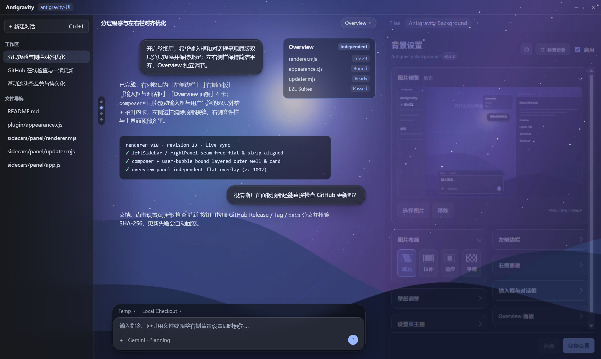
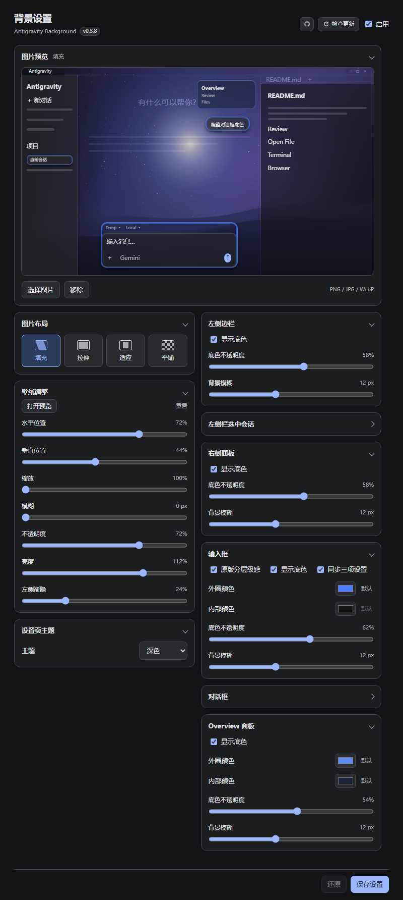
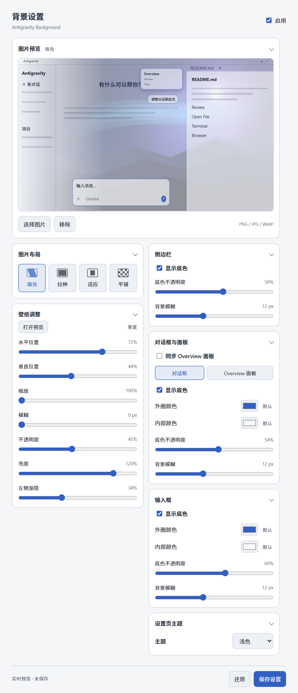
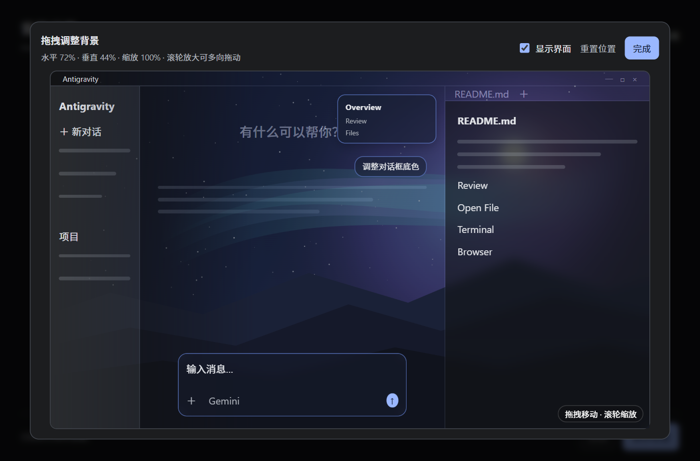

<div align="center">


# Antigravity Background

**Windows 版 Antigravity 全窗壁纸与磨砂表面定制插件**

[](plugin.json)
[](#安装与入口)
[](#安装与入口)
[](docs/adr/0001-live-preview.md)

[效果展示](#效果展示) · [核心功能](#核心功能) · [安装与入口](#安装与入口) · [持久化机制](#跨重启持久化与自修复) · [交互兼容](#原生交互与兼容修复) · [仓库结构](#仓库结构)

</div>

---

**Antigravity Background**（插件名 `antigravity-ui`）通过 Antigravity 官方 Sidecar 扩展机制在右侧辅助面板提供实时可视化设置界面，支持自定义整窗壁纸、多种裁剪/平铺布局、交互式拖拽预览、**左侧边栏 / 右侧面板 / Overview 面板**透明与毛玻璃定制、**输入框与对话框**同步的原版双层立体分层级感与外内配色，以及深浅主题自适应与双保险跨重启持久化。

## 效果展示

### 主窗口全窗壁纸与磨砂界面效果

> 壁纸固定铺满整个窗口并覆盖顶部栏与左侧栏，同时保持左侧圆点进度条、分栏拖拽手柄、Overview 面板与右侧扩展设置页完整清晰可交互。



### 设置面板（深色 / 浅色主题）与弹窗拖拽调整

<table>
  <tr>
    <td width="50%" align="center">
      
      <br />
      <sub><b>深色主题设置页</b> · 全部 7 组折叠卡（含输入框与对话框绑定 &amp; 独立 Overview 面板）</sub>
    </td>
    <td width="50%" align="center">
      
      <br />
      <sub><b>浅色主题设置页</b> · 「左侧边栏」「右侧面板」「输入框与对话框」「Overview 面板」各自独立配置</sub>
    </td>
  </tr>
  <tr>
    <td colspan="2" align="center">
      
      <br />
      <sub><b>「壁纸调整 → 打开预览」弹窗</b> · 1:1 同步宿主窗口比例与分栏宽度，支持拖拽定位、滚轮缩放与界面遮罩切换</sub>
    </td>
  </tr>
</table>

---

## 核心功能

| 模块 | 功能说明 | 可调范围 / 默认行为 |
| --- | --- | --- |
| **壁纸与布局** | 支持本地 **PNG / JPG / WebP**，最长边自动压缩至 `2560px` 并保留透明通道；支持 **填充 / 拉伸 / 适应 / 平铺** 四种模式 | 填充 · 拉伸 · 适应（默认） · 平铺 |
| **精细参数调节** | 水平位置（`0–100%`）、垂直位置（`0–100%`）、缩放（`20–220%`）、模糊（`0–30 px`）、不透明度（`0–100%`）、亮度（`30–140%`）、左侧渐隐（`0–95%`） | 全模式基于容器查询（`cqw` / `cqh`）按窗口等比自适应，切屏、变分辨率/DPI 及全屏↔窗口化均保持位置与比例一致；修改即刻实时预览 |
| **弹窗拖拽预览** | 顶部「图片预览」按真实 Antigravity 窗口宽高比与分栏比例等比渲染（只读防误触）；点击「壁纸调整 → 打开预览」弹出交互画布，支持自由拖拽与滚轮缩放 | 非平铺模式缩放实效下限 `100%`，位移按可移动余量贴边限位，防止露出未覆盖留白 |
| **左侧边栏表面** | 独立控制「显示底色」、底色不透明度（`0–100%`）与背景模糊（`0–30 px`） | 单层平滑覆盖左侧栏，透明化内部吸顶 `.bg-sidebar` 色块与悬停渐变，消除顶部内阴影接缝 |
| **右侧面板表面** | 独立控制「显示底色」、底色不透明度（`0–100%`）与背景模糊（`0–30 px`） | 单层覆盖标签栏下方 `[data-side-panel-body]`（兼容 `[data-has-browser-hole]`），保持顶部文件标签条与主界面齐平 |
| **输入框与对话框** | 单卡绑定整合，共享控制「原版分层级感」「显示底色」、外圈/内部 hex 颜色、不透明度与模糊 | 同时作用于普通/起始页输入框（含顶部工具条）与全部用户消息气泡，兼容长对话滚动模糊与纯透玻璃边框 |
| **Overview 面板** | 独立扁平控制卡：支持「显示底色」、外圈/内部 hex 颜色、底色不透明度与背景模糊 | 独立覆盖 4 类 Overview 面板宿主，从不与输入框/对话框同步，保持轻量扁平与高交互层级 |
| **主题与多窗口同步** | 设置页支持「跟随应用 / 深色 / 浅色」并随配置保存；多窗口实时发现、同源多标签页 `BroadcastChannel` 联动、磁盘 `settings.json` 外部变更重载 | 实时预览保留于内存草稿；点击「保存设置」落盘，点击「还原」放弃未保存草稿 |
| **在线检查与一键更新** | 顶部标题栏显示当前版本号、GitHub 仓库图标与 **「检查更新」** 按钮；自动识别 GitHub Release（ZIP + SHA-256 校验）、Tag / `main` 分支与 Atom 退路 | 安装失败时尝试回滚，回滚失败时保留备份和事务日志以便启动时恢复。更新完成后可一键热重载插件，打开面板时不主动发起联网请求 |

新版更新器可回收已退出进程留下的目录锁。若面板提示旧版更新锁仍存在，请先退出持有该锁的 Antigravity 客户端。若确认旧进程均已退出且锁文件仍在，可移除 `.gemini/config/plugins/.antigravity-ui-update.lock` 这个旧版锁文件，再启动插件恢复。

---

## 安装与入口

### 环境要求

- **系统**：Windows
- **运行时**：[Node.js](https://nodejs.org/) **22.2** 或更高版本
- **宿主**：已安装桌面版 Antigravity

### 一键安装 / 卸载 / 状态检查

1. 完全退出 Antigravity（确认系统托盘图标已退出）。
2. 双击运行根目录下的 [`Antigravity-UI.cmd`](Antigravity-UI.cmd)，按提示选择：
   - `1`：安装 / 更新插件（含双保险持久化配置）
   - `2`：卸载插件（自动还原 `app.asar` 与快捷方式参数，保留图片设置与恢复备份）
   - `3`：查看安装与持久化状态

使用自定义 Antigravity 安装目录或需要命令行自动化时，可直接调用 [`manage.cjs`](manage.cjs)：

```powershell
# 安装或更新（可选指定安装目录）
node manage.cjs install
node manage.cjs install "D:\Antigravity"

# 查看插件、app.asar 自启开关、快捷方式与当前调试端口状态
node manage.cjs status

# 卸载并无损恢复宿主原始状态
node manage.cjs uninstall
```

### 在 Antigravity 中打开

- 安装位置：`~/.gemini/config/plugins/antigravity-ui`
- 安装器会在 `~/.gemini/config/config.json` 中自动启用 `plugins.antigravity-ui` 与 `sidecars["antigravity-ui/panel"]`，同时保留其他已有配置并自动备份原配置。
- 重启 Antigravity 后：
  - 可在 **「Customizations → Installed」** 查看 **Antigravity Background**。
  - 在会话右侧打开辅助侧边栏，通过 **「Extensions → Antigravity Background」** 进入背景设置页。

---

## 跨重启持久化与自修复

Antigravity 桌面端仅在开启本地环回调试端口（`--remote-debugging-port=0 --remote-debugging-address=127.0.0.1`）时才会生成 `DevToolsActivePort` 供 Sidecar 自动连接注入背景；若通过无参数快捷方式、协议链接或应用自重启打开，宿主会主动清理该文件导致背景无法自动附加。

为此插件内置了可逆的双保险持久化机制（[`plugin/persistence.cjs`](plugin/persistence.cjs)）：

1. **快捷方式参数托管**：安装时自动扫描桌面、OneDrive 桌面、开始菜单及任务栏固定栏中的 Antigravity 快捷方式（含透传参数的 `AntigravityLauncher.exe` 快捷方式），幂等补齐 `--remote-debugging-port=0 --remote-debugging-address=127.0.0.1`，并在 `~/.gemini/config/antigravity-ui.shortcuts.bak.json` 备份原始参数。
2. **`app.asar` 极简自启开关**：在退出 Antigravity 执行安装时，向 `resources/app.asar` 的 `dist/main.js` 模块入口注入仅限本机 `127.0.0.1` 的 `app.commandLine.appendSwitch` 启动开关及 `dist/antigravity-ui/persist.json` 标记，同时生成带 SHA-256 校验的 `app.asar.antigravity-ui.persist.<sha256>.bak` 备份；即使从裸程序或 `antigravity://` 协议拉起也可持久生效。卸载时按哈希校验无损还原原版 `app.asar` 与所有快捷方式。
3. **缺口期友好提示与一键修复**：当检测到宿主未开启调试端口（`MISSING_DEVTOOLS_PORT`）或客户端版本更新覆盖了 `app.asar` 时，侧栏底栏会自动显示中文引导提示与 **「修复快捷方式」** 按钮（`POST /api/repair-shortcuts`）；更新客户端后再次执行 `Antigravity-UI.cmd` 选 `1` 即可恢复全路径持久化。
4. **旧版补丁自动迁移**：安装器自动识别早期版本（`dist/antigravity-ui/original.json`）补丁，校验原始资源备份并清理迁移，首次运行自动读取旧版 `antigravity-ui-wallpaper.json` 配置。

---

## 原生交互与兼容修复

针对全窗壁纸层（`z-index: 1000`）与半透明内容区抬升后可能带来的原生界面兼容问题，渲染器（`version = 18 / revision = 27`）持续做了系统性适配：

- **对话区与原生控件层级还原**：恢复左侧对话圆点进度条（`conversation-navigator`）点击跳转、主滚动条与回到底部按钮、`Ctrl+F` 查找栏、选中浮窗/批注弹框、底部终端上边缘拖拽调整高度、分栏拖拽手柄（`[data-split-sash]` / `[data-testid="tiling-splitter"]`）及侧栏收起 Peek 热区/窄窗抽屉交互。
- **工作状态框浮动滚动条视口裁剪**：为宿主全局挂载到 `document.body` 的浮动滚动条（`body > [data-overlay-scrollbar-track]`）建立几何反查与祖先裁剪链，通过 `clip-path: inset(...)` 限制其严格在 `[data-testid="autoscroll-viewport"]` 等容器视口内渲染与响应点击，杜绝长工作流状态框滚出会话区域时遮挡顶部标题栏、会话头或底部输入框。
- **标题栏与原生浏览器视图隔离**：通过 `MutationObserver` 与主题签名过滤保护透明 `titleBarOverlay`，同步标准化 `color(srgb ...)` 色彩格式；在侧栏切换至原生 `[data-browser-hole]` 标签页时解除主区 `clip-path` 陷阱、恢复停靠左侧栏底层 `--shell-canvas` 画布色（消除顶栏下方暗色断层），并保持浏览器孔洞全透明无模糊遮挡。
- **跨屏不同分辨率与全屏/窗口化一致渲染**：为 `#antigravity-ui-background` 与预览 `.sample-window` 启用 `container-type: size`，所有布局模式（其中 `tile` 自由缩放采用宽高面积均衡 `(50cqw + 50cqh × r) × scale`，在全屏切 1:1/半屏窗口化时不骤缩）与壁纸模糊半径统一基于容器单位（`cqw`/`cqh`）和真实自然宽高比 `--ag-ui-image-aspect` 纯 CSS 实时计算，移除 `transform: scale()` 以避免放大时偏移左侧渐隐遮罩或倍增模糊，并在宿主 `resize` / DPI 变化时即时刷新窗口布局比例。

---

## 常见问题

<details>
<summary><b>1. 重启 Antigravity 后提示“未检测到本地调试端口”怎么办？</b></summary>

1. 先在设置页底栏点击 **「修复快捷方式」**，随后完全退出 Antigravity 并通过桌面或开始菜单快捷方式重新打开。
2. 如希望无论任何启动方式（包括协议拉起或裸程序启动）都能自动生效，请在退出 Antigravity 后运行一次 `Antigravity-UI.cmd` 选择 `1` 重新写入 `app.asar` 自启开关（客户端版本更新覆盖 `app.asar` 后需重跑一次）。

</details>

<details>
<summary><b>2. 没有立即看到“实时预览”或修改没保存到下次打开？</b></summary>

- 拖动滑块、切换开关和颜色属于**实时预览**（保存在 Sidecar 运行时内存中，刷新侧栏不会丢失）。
- 只有点击右下角 **「保存设置」** 后才会写入本地配置文件长期保留；点击 **「还原」** 可放弃未保存调整并恢复上次保存的配置。

</details>

<details>
<summary><b>3. 为什么非“平铺”模式下缩放最小只能到 100%？</b></summary>

为避免壁纸缩小后四周露出原生深/浅纯色边界，非 `tile` 模式启用了全铺边界保护（缩放下限 `100%` 并在「打开预览」弹窗拖拽时按实际余量贴边钳制）；若希望缩小壁纸并按壁纸背景边界颜色向四周拓展，可切换布局为 **「平铺」**（支持 `20%–220%`，且不再拼接重复原图）。

</details>

<details>
<summary><b>4. 如何运行内置回归测试？</b></summary>

项目提供无头 Chrome + 隔离 Sidecar 的完整端到端回归测试套件（覆盖表面渲染、拖拽边界保护、多窗/多面板同步、原生控件点击命中、浮动滚动条视口裁剪、`app.asar`/快捷方式持久化、GitHub 在线更新安全归档与回滚校验，以及文档与源码同步校验）：

```powershell
node tests/background-rendering.mjs
node tests/updater.mjs
node tests/docs-sync.mjs
```

</details>

---

## 仓库结构

```text
antigravity-UI/
├── Antigravity-UI.cmd              # Windows 交互式安装 / 卸载 / 状态入口
├── manage.cjs                      # CLI 安装管理与旧版补丁迁移
├── plugin.json                     # Antigravity 插件清单
├── AGENTS.md                       # 维护者与 Agent 路由指南
├── ARCHITECTURE.md                 # 当前态架构、状态机与接口索引
├── GLOSSARY.md                     # 核心术语说明
├── assets/
│   └── logo.png                    # 插件图标
├── plugin/
│   ├── appearance.cjs              # 配置归一化、表面默认参数与壁纸样式生成
│   └── persistence.cjs             # app.asar 自启开关与快捷方式备份/修复共享模块
├── sidecars/panel/
│   ├── sidecar.json                # Sidecar 注册配置（右侧扩展面板）
│   ├── main.mjs                    # Sidecar HTTP 服务与设置/更新/快捷方式修复 API
│   ├── runtime.mjs                 # CDP 窗口发现、连接复用与健康状态检测
│   ├── renderer.mjs                # 宿主窗口壁纸注入、层级适配与浮动滚动条裁剪
│   ├── store.mjs                   # 原子写入与 mtime 外部变更重载存储
│   ├── updater.mjs                 # GitHub Release/Tag/main 更新检查、校验与热重载
│   ├── archive.mjs                 # 安全的 ZIP / TAR.GZ 解压与运行时清单校验
│   ├── sdk.mjs                     # Sidecar SDK 加载器
│   ├── index.html                  # 设置页、拖拽预览弹窗与插件更新弹窗 DOM
│   ├── styles.css                  # 设置页深浅主题与嵌入式样式
│   └── app.js                      # 实时预览、BroadcastChannel 同步与更新/交互控制
├── docs/
│   ├── adr/0001-live-preview.md    # 架构决策与演进记录（§1 – §18）
│   └── images/                     # README 展示截图
└── tests/
    ├── background-rendering.mjs    # 隔离环境渲染、交互与持久化回归测试
    ├── updater.mjs                 # 更新器归档安全、代理与端到端回归测试
    └── docs-sync.mjs               # 文档与源码清单/接口/链接双向同步校验
```

---

## 设计文档

- 当前架构、状态机与接口索引：[ARCHITECTURE.md](ARCHITECTURE.md)
- 维护约定与验证回路：[AGENTS.md](AGENTS.md)
- 架构演进与技术细节记录：[docs/adr/0001-live-preview.md](docs/adr/0001-live-preview.md)
- 术语定义：[GLOSSARY.md](GLOSSARY.md)
